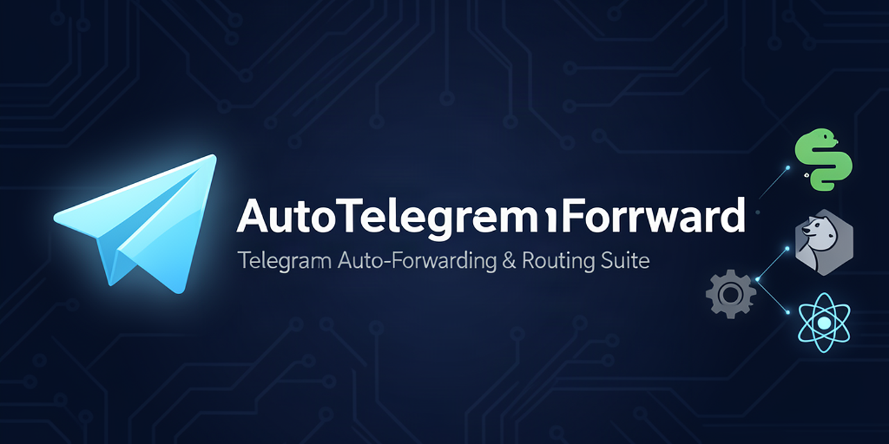

# AutoTelegramForward (v2.0)

<p align="center">
  
</p>

<p align="center">
  <a href="https://github.com/Opselon/AutoTelegramForward/releases/latest"></a>
  <a href="https://github.com/Opselon/AutoTelegramForward/actions/workflows/ci.yml"></a>
  <a href="https://github.com/Opselon/AutoTelegramForward/actions/workflows/codeql.yml"></a>
  <a href="https://opselon.github.io/AutoTelegramForward/"></a>
  <a href="https://opensource.org/licenses/MIT"></a>
</p>

<p align="center">
  
  
  
  
  
  
  
</p>

> 🌐 **Official Website, Documentation & Live Transformation Playground:** [https://opselon.github.io/AutoTelegramForward/](https://opselon.github.io/AutoTelegramForward/)

---

## ⚡ Quick start — one command, on any platform

Every path below ends in the same place: a guided wizard that detects the
machine, asks only what it cannot work out itself, validates every answer, builds
the four microservices, and then **proves** each one is serving.

### 🐧 Linux / macOS / WSL
```bash
git clone https://github.com/Opselon/AutoTelegramForward && cd AutoTelegramForward
./scripts/setup.sh            # venv + deps + `atf` on PATH + guided setup
./scripts/setup.sh --check    # read-only readiness report, changes nothing
```
`scripts/setup.sh` hands over to `scripts/bootstrap.py`, which picks a Python in
the supported range (**3.11–3.13**), creates `.venv`, installs dependencies,
symlinks `atf` into `/usr/local/bin`, and starts the wizard. If your `python3` is
3.14 it will say so and use `python3.13`/`3.12`/`3.11` instead — 3.14 is not
usable here, because the pinned pyrogram imports an event loop that 3.14 no
longer creates implicitly (docker images pin 3.11, so docker mode is unaffected).

### 🪟 Windows (PowerShell, or Git Bash/WSL)
```powershell
git clone https://github.com/Opselon/AutoTelegramForward; cd AutoTelegramForward
python scripts\bootstrap.py
```
Identical steps to Linux — the same file, not a second implementation. It uses
Docker Desktop (WSL2 backend) when docker is available and offers source mode when
it is not.

### 🌐 Zero-prerequisite installers
```bash
curl -fsSL https://raw.githubusercontent.com/Opselon/AutoTelegramForward/master/install.sh | bash   # Linux/macOS/WSL/*BSD
```
```powershell
irm https://raw.githubusercontent.com/Opselon/AutoTelegramForward/master/install.ps1 | iex        # Windows
```
Both install Python/git when missing, clone the repo, and end in the same wizard.

### 📦 Portable single file (no install, no venv, no checkout)
Needs only Python 3.11–3.13 on the target machine:
```bash
python3 atf.pyz platform      # what this host is, and the exact docker install commands for it
python3 atf.pyz setup         # the same wizard
```
Build it from a checkout with `atf release portable` → `dist/atf.pyz` (~88 KB,
standard library only, runs on Linux/macOS/Windows).

### 🐳 Docker Compose only (no CLI)
```bash
cp .env.example .env          # fill ATF_API_ID, ATF_API_HASH, ATF_BOT_TOKEN, ADMIN_USER_ID
docker compose up -d
docker compose ps             # atf-core, atf-logger, atf-api, atf-web
```

Optional AI-gateway overlay: if you also self-host the 9router AI provider as a
sibling stack and want Core/API to reach it by its internal hostname,
```bash
docker compose -f docker-compose.yml -f docker-compose.9router.yml up -d
```
(the overlay attaches both services to `9router_default`; the base stack without
the overlay is fully functional, it just cannot resolve `9router`).

| You have | Use | Result |
| --- | --- | --- |
| docker + python 3.11–3.13 | `./scripts/setup.sh` | docker mode: full stack, verified, boot service optional |
| python 3.11–3.13 only | `atf setup --source-wizard` | source mode: venv + supervised local processes |
| neither, want one file | `atf release portable` → `atf.pyz` | portable: copy one file, run `setup` |
| Windows + Docker Desktop | `python scripts\bootstrap.py` | docker mode on WSL2 |
| only want the containers | `docker compose up -d` | the stack, managed by hand |

---

## 🏛️ Architecture & Microservice Topology

AutoTelegramForward v2.0 is engineered with strict, fail-closed microservice boundaries and Domain-Driven Design (DDD):

```
┌────────────────────────┐      ┌─────────────────────────┐
│   React SPA Dashboard  │      │   Flutter Mobile App    │
│  (Modern Browser UI)   │      │     (Android / iOS)     │
└───────────┬────────────┘      └────────────┬────────────┘
            │ HTTP / WebSocket               │ REST / JSON
            ▼                                │
┌────────────────────────┐                   │
│    Rust Web Gateway    │ HTTP Reverse Proxy│
│   + Axum BFF (:8088)   │ ──────────────────┼─────────────────────────┐
└────────────────────────┘                   │                         │
                                             ▼                         │
                                ┌─────────────────────────┐            │
                                │   Go REST API Gateway   │            │
                                │  Control Plane (:8080)  │            │
                                └────────────┬────────────┘            │
                                             │ gRPC (:50051)           │ gRPC (:50052)
                                             ▼                         ▼
                                ┌─────────────────────────┐ ┌─────────────────────────┐
                                │   Python MTProto Core   │ │  Rust Logger Engine     │
                                │  Forwarder Engine (:50051) │ (:50052, SQLite DB) │
                                │  ClientPool + SQLite DB │ └─────────────────────────┘
                                └─────────────────────────┘
```

1. **Rust Axum Web Gateway & React Dashboard (`:8088`)**
   - Zero-dependency embedded web server: React SPA assets are compiled directly into the binary.
   - High-throughput reverse proxy routing `/api/*` to the Go Control Plane.
   - Hardened security headers (`CSP`, `X-Content-Type-Options`, `X-Frame-Options: DENY`, `X-XSS-Protection`).
   - Public health endpoint (`/healthz`) and live system topology viewer.

2. **Go REST API & Control Plane (`:8080`)**
   - Authoritative public REST control interface with OpenAPI documentation.
   - High-performance authentication (Bearer JWT + TMA Telegram Mini App validation).
   - Strict multi-tenant isolation guarding rules, sessions, filters, and AI configurations.
   - Strictly decoupled from databases; communicates with backend engines solely via gRPC.

3. **Python Core / Telegram MTProto Engine (`:50051`)**
   - Exclusive owner of Telegram MTProto client pools, MTProto event loops, and business routing logic.
   - Domain-Driven Design (DDD) rule evaluation pipeline, content sanitization, deduplication, and AI transformations.
   - Encrypted SQLite persistence (`data/atf.db`) utilizing AES-256-GCM for sessions and keys.

4. **Rust Central Logger Engine (`:50052`)**
   - Autonomous telemetry and structured observability microservice with dedicated storage (`data/atf_logs_rust.db`).
   - Standardized `[PIPELINE:...]` logging with live retention, filtering, and queryable gRPC/REST APIs.
   - Ingest-time secret redaction, at-least-once producer delivery and a bounded diagnostic window.

5. **Flutter Mobile Client (Android & iOS)**
   - Production native mobile application with secure credential and password persistence.
   - Automated server URL reachability probing and protocol version compatibility checks.
   - Full RTL/LTR multilingual interface mirroring 100% of dashboard capabilities.

6. **`atf` Unified Process Supervisor CLI**
   - Single-file orchestrator that coordinates orderly startup (`logger` -> `core` -> `api` -> `web`), graceful shutdown, crash recovery, and health checks across Linux, macOS, and Windows.

---

## 🚀 What is New in v2.0

- 🧹 **Advanced Content Cleaner & Sanitizer**:
  Strip links, `@mentions`, `#hashtags`, emojis, and custom regex patterns per rule, with preview and dynamic toggle.
- 🧬 **Message Deduplication Engine**:
  SHA-256 content and album fingerprinting to eliminate duplicate and repeated forwards across all channels.
- 🔁 **Reply Synchronization (`sync_replies`)**:
  Preserves conversational hierarchy across channels by automatically mapping and linking replies between source and target.
- 🏷️ **Show Forward Header Toggle**:
  Seamlessly choose between native Telegram quote forwarding (preserving author channel header) and clean direct copy.
- 🌐 **10-Language 1:1 Parity**:
  Comprehensive, 100% catalog parity (378 keys) across English (`en`), Persian (`fa`), Russian (`ru`), Chinese (`zh`), Portuguese (`pt`), Uzbek (`uz`), Indonesian (`id`), Spanish (`es`), French (`fr`), and Italian (`it`) with fail-closed English fallback.
- 🎛️ **Interactive Telegram Bot Submenus**:
  Full visual configuration for Cleaner, Filters, Delay, Blacklist, Whitelist, and Replacements with dynamic status badges.
- 📊 **Modular Task Overview Modal**:
  6 modular inspection cards in the React Dashboard for in-depth rule auditing and live parameter adjustments.
- 🩺 **Live Topology & Services Health**:
  Real-time sub-millisecond health probing across all 4 services with latency, uptime, and dynamic alerts.
- 🛡️ **Hardened Multi-Tenant Defense**:
  Strict fail-closed numeric Telegram ID authorization; zero cross-tenant leak of sessions, rules, or logs.
- 📋 **Professional Structured Pipeline Logging**:
  Uniform `[PIPELINE:DISPATCH]`, `[PIPELINE:DELIVERED]`, `[PIPELINE:DROP]` logs for complete auditing and troubleshooting.

---

## 🎛️ Feature Comparison Matrix

| Feature | Telegram Bot UI | Web Dashboard | Mobile App (Flutter) | Go REST API |
|---|:---:|:---:|:---:|:---:|
| **Channel / Group / PV Forwarding** | ✅ | ✅ | ✅ | ✅ |
| **Interactive Login (Phone/OTP/2FA)** | ✅ | ✅ | ✅ | ✅ |
| **Cleaner & Pattern Removal** | ✅ | ✅ | ✅ | ✅ |
| **Deduplication & Content Hashing** | ✅ | ✅ | ✅ | ✅ |
| **Reply & Edit Synchronization** | ✅ | ✅ | ✅ | ✅ |
| **Forward Header (Quote) Mode** | ✅ | ✅ | ✅ | ✅ |
| **Delay & Scheduled Auto-Delete** | ✅ | ✅ | ✅ | ✅ |
| **10 Languages Localization** | ✅ | ✅ | ✅ | ✅ |
| **AI Rewriting (OpenAI/Claude/Gemini/DeepSeek)** | ✅ | ✅ | ✅ | ✅ |
| **Live Topology & Health Probing** | ✅ | ✅ | ✅ | ✅ |
| **Encrypted Backup & Migration (.atf)** | ✅ | ✅ | ✅ | ✅ |

---

## 📥 Download Official Releases

Every platform release provides a self-contained executable embedding all microservices with zero external dependencies:

| Binary Artifact | Platform | Architecture | Description |
|---|---|---|---|
| `atf-linux-x64` | Linux | x86_64 | Self-contained standalone single executable |
| `atf-linux-arm64` | Linux | ARM64 / aarch64 | Raspberry Pi 4/5, ARM VPS, AWS Graviton |
| `atf-macos-x64` | macOS | Intel x86_64 | macOS standalone binary |
| `atf-macos-arm64` | macOS | Apple Silicon (M1–M4) | Native Apple Silicon binary |
| `atf-windows-x64.exe` | Windows | x64 / ARM64 | Native Windows executable |
| `AutoTelegramForward-*-arm64.apk` | Android | ARM64 | Mobile release APK |
| `AutoTelegramForward-*-bundle.aab` | Android | Universal | Google Play Store bundle |

👉 **Browse all downloadable artifacts on [Releases Page](https://github.com/Opselon/AutoTelegramForward/releases/latest)**.

---

## 💻 CLI Command Reference

The unified `atf` CLI manages the entire lifecycle of all services:

```bash
atf setup             # First-time interactive or headless setup wizard
atf start             # Start ALL 4 microservices (logger -> core -> api -> web)
atf stop              # Gracefully stop all microservices with state cleanup
atf restart           # Safe sequential restart
atf status            # Check live status, PIDs, and listening ports
atf health            # Deep multi-layer diagnostics (DB, binaries, ports, gRPC)
atf logs              # Real-time streaming service logs with filtering
atf version           # Display version and runtime execution mode
atf service install   # Install OS background daemon (systemd / launchd / TaskScheduler)
atf docker up/down    # Full Docker Compose orchestration
atf k8s apply/status  # Production Kubernetes cluster deployments
atf test              # Run multi-stack test suites
```

---

## 🤖 Telegram Bot — Pro Button UI

Start the bot with `/start` to access the interactive panel without typing complex commands:

| Panel | Functionality |
|---|---|
| 📱 **Login** | Link a user account: Phone number -> Telegram OTP -> 2FA Password -> Encrypted session |
| 🔀 **Rules** | Create, view, toggle, edit, or delete forwarding rules |
| 🧹 **Cleaner** | Strip URLs, @mentions, #hashtags, emojis, and custom regex patterns |
| 🎛️ **Filters** | Configure keyword whitelists, blacklists, and media filters |
| 🤖 **AI Rewrite** | Connect OpenAI, Anthropic, Gemini, Groq, DeepSeek, or custom LLMs |
| 📋 **Logs** | Browse debug logs filtered by service and log level |
| 📊 **Stats** | Real-time forwarding counts, rate metrics, and system throughput |
| 🌐 **Language** | Switch on-the-fly between all 10 supported languages |
| 💾 **Backup** | Export and restore AES-256-GCM encrypted `.atf` configurations |

---

## 🔌 REST API Endpoints (Go Control Plane, `:8080`)

```http
# Setup & readiness (auth as usual; booleans only — no secret value is ever returned)
GET /api/system/setup            # ready verdict + version + env contract + live service probes
GET /api/system/setup?probe=0    # the same, instantly, without probing services
GET /api/system/env              # configuration contract: each key with set:true/false and a fix hint
GET /api/health/services         # per-service reachability, latency and detail (core/logger/api/web)
```


All API endpoints are documented with OpenAPI schemas:

```http
# Health & Telemetry
GET    /healthz
GET    /api/v1/health/services

# Forwarding Rules & Settings
GET    /api/v1/rules
POST   /api/v1/rules
GET    /api/v1/rules/{id}
PUT    /api/v1/rules/{id}
DELETE /api/v1/rules/{id}
POST   /api/v1/rules/{id}/pause
POST   /api/v1/rules/{id}/resume

# Session Management
GET    /api/v1/sessions
POST   /api/v1/sessions/backup
POST   /api/v1/sessions/restore
DELETE /api/v1/sessions/{id}

# Filters & AI Configurations
GET    /api/v1/filters
POST   /api/v1/filters
PUT    /api/v1/filters/{id}
DELETE /api/v1/filters/{id}
GET    /api/v1/ai
POST   /api/v1/ai
POST   /api/v1/ai/{id}/test

# Observability Logs
GET    /api/v1/logs?service=&level=&search=&limit=&since=
GET    /api/v1/logs/stats
POST   /api/v1/logs/purge
```

---

## 🧪 Comprehensive Automated Test Suites

AutoTelegramForward maintains strict test gates across every tier:

```bash
# Python MTProto Core (507+ tests: DDD, crypto, cleaner, pipeline, gRPC, FSM)
pytest core/tests -q

# Go REST API Control Plane (100% passing: auth, tenant isolation, metadata validation)
cd api && go test -v ./...

# Flutter Mobile Application (50+ tests: models, storage, isolation, localization)
cd mobile && flutter test
```

---

## 🔒 Security & Privacy Standard

- **Zero Plaintext Credentials**: All session strings, bot tokens, and AI API keys are encrypted at rest with AES-256-GCM derived from your `master_key`.
- **Fail-Closed Multi-Tenant Defense**: Authorization is strictly enforced using immutable numeric Telegram User IDs (`user.id`), never mutable usernames.
- **Network Isolation**: The Python Core and the Rust logger bind to private gRPC interfaces and do not expose unauthenticated public ports (the logger's metrics/health surface is container-internal).
- **Audit Logging**: Sensitive tokens and private credentials are automatically redacted (`[REDACTED]`) before reaching logs or error traces.

---

## 🤖 Agent & Contributor Guidelines

Autonomous AI agents and developers working on this codebase must follow the mandatory engineering rules documented in [`docs/agent-rules.md`](docs/agent-rules.md) and [`AGENTS.md`](AGENTS.md):
- **Mandatory Multilingual UI**: Zero hardcoded UI strings; strict 1:1 catalog parity across all 10 supported locales (`en`, `fa`, `ru`, `zh`, `pt`, `uz`, `id`, `es`, `fr`, `it`) with English fallback.
- **Fail-Closed Multi-Tenant Isolation**: Authoritative checks using immutable numeric Telegram User IDs.
- **Pre-Commit Quality Gates**: Mandatory execution and passing of `scripts/audit_cross_language.py` and `scripts/audit_telegram_i18n.py`.

---

## 📄 License

This project is licensed under the **MIT License** — see the [LICENSE](LICENSE) file for details.

## One-command setup, startup, and validation

The `atf` CLI manages the whole stack (rules, sessions, logs, data, admin, config)
**and** the deployment (docker, build, deploy, restart, health, logs, net, certs, db)
with an automated full-system upgrade path.

```bash
./scripts/setup.sh          # fresh checkout: venv + CLI + preflight + build + start + health
atf setup                   # the same sequence, guided, with a per-step summary table
atf setup --check           # read-only readiness report — changes nothing
atf setup --source-wizard   # legacy bare-metal wizard (config.yaml + supervised processes)
```

### Everyday lifecycle

```bash
atf up                      # build + start the whole stack (shortcut for `system start`)
atf down                    # stop the containers (`system stop`)
atf restart                 # restart and re-verify health (`system restart`)
atf status                  # live board: services, ports, rules
atf system services         # microservice table: state, health, reachability, endpoint, version
atf platform                # what this host is + how to install docker on it
atf doctor --fix            # repair whatever the checks flag
atf upgrade check           # is a newer revision available? (exit 10 = yes, for cron)
atf upgrade apply           # preflight → backup → pull → build → recreate → verify, with a rollback point
atf system upgrade          # docker-only shortcut: pull → build → recreate → alias repair → health gate
atf system service install  # start the stack at boot (systemd unit)
atf release portable        # build dist/atf.pyz — the single-file CLI
```

`atf up` is **validator-gated**: it runs the static validation below first and
refuses to start on a blocking failure (override with `--force`).

### `atf validate` — the CI-safe validator

Read-only: no builds, no container churn, no repairs. Exit code is `0` only when
every check passes, so it works as a pre-deploy gate (`--strict` promotes
warnings to failures; `--runtime` adds the live stack checks; `--deep` runs the
repo's own i18n audits).

| Check | What it proves |
| --- | --- |
| `layout` | complete checkout (compose, Dockerfiles, CLI, services) |
| `version` | `VERSION` is a sane semver |
| `env-file`, `env-keys`, `env-optional` | `.env` exists; required keys populated; optional keys not left at their example value |
| `env-secrets`, `env-perms` | secret length floor met; `.env` is not group/world readable |
| `env-typos` | no stray keys that the example file does not document |
| `env-ignored` | `.env` is git-ignored |
| `compose` | `docker-compose.yml` parses cleanly |
| `catalog`, `catalog-placeholders`, `catalog-rtl` | 1:1 key parity + placeholder parity across all 10 locales; English values carry no RTL script |
| `secrets-scan` | no credential-shaped literal in any tracked file |
| `database` | SQLite `integrity_check` passes (read-only) |
| `proto` | generated stubs are not older than the `.proto` sources |
| `ports` | the ATF ports are not held by a foreign process |

`--runtime` additionally proves the live deployment: `containers` (all four
running), `network aliases` (compose aliases + the external AI bridge attached),
`api` (`/healthz` + upstream session), `services` (all four answering over gRPC and
HTTP), `certificate` (TLS expiry), and `container-env` — which asks the running API
which configuration it actually received and fails when the container is older than
`.env`, i.e. the "I set the token but the bot still says unconfigured" bug.

```bash
atf validate                 # human report with per-check fixes
atf validate --json          # exactly one JSON object on stdout (scripts, cron, CI)
atf validate --strict        # non-zero exit on warnings too
```

Every command supports `--json` (one JSON document on stdout, placed before or
after the group name), and every line the CLI writes goes through a single
redaction filter, so a leaked bot token or API key cannot appear in a transcript.

### Upgrading the stack (`atf upgrade`)

`atf update` is an alias of `atf upgrade`. The engine answers one question —
*what exactly will change, and how do I get back?* — before it changes anything.

```bash
atf upgrade check            # installed vs available revision; exit 10 when an upgrade is available
atf upgrade plan             # the 7 steps it would run, in order, changing nothing
atf upgrade apply            # do it
atf upgrade rollback         # return to the revision recorded before the last upgrade
atf upgrade history          # every recorded upgrade and rollback
```

| Exit code | Meaning |
| --- | --- |
| `0` | up to date, or the upgrade succeeded |
| `1` | the upgrade ran and failed (the failing step is named) |
| `3` | it cannot upgrade in this state — dirty tree, detached HEAD, diverged branch |
| `10` | an upgrade is available (`upgrade check` only — cron-friendly) |

An upgrade is a fixed sequence, and `plan` prints the same list `apply` executes:

1. **preflight** — git checkout, docker, free disk
2. **backup** — snapshot the database before anything is touched
3. **move** — fast-forward to the target revision (never a merge, never a reset)
4. **build** — `docker compose build`
5. **recreate** — `docker compose up -d`, containers replaced and aliases repaired
6. **verify** — doctor checks plus port diagnosis
7. **record** — the previous revision is written to `.atf/upgrade-state.json`

The state file is written *before* the move, so `rollback` always has a way back
even if the build fails halfway. Uncommitted work is a refusal, not a surprise:
`--stash` parks it (`git stash pop` brings it back) and `--force` overrides.

```bash
atf upgrade apply --no-build --no-verify      # reuse the current images; verify by hand later
atf upgrade apply --stash                     # park a dirty tree instead of refusing
atf upgrade apply --ref v2.1.0                # an exact tag, branch or commit
atf upgrade check --no-fetch                  # never contact the remote
```

On a **source** install (no docker) the engine adapts instead of refusing: it
refreshes the virtualenv where the docker path would rebuild images, skips the
container recreate and the database snapshot, and picks the doctor checks that
apply to a bare metal deployment. `--dry-run` never writes — but it still reads
the repository, so `atf --dry-run upgrade plan` reports the real revision, branch
and ahead/behind instead of claiming the checkout is missing.

### `atf doctor --only` — one check at a time

```bash
atf doctor --only ports            # just the port diagnosis
atf doctor --only docker repo disk # as many as you name
atf doctor --fix --rebind-ports    # repair aliases and move services off a foreign port
```

The names are the check names: `docker`, `python`, `repo`, `containers`,
`aliases`, `ports`, `firewall`, `api`, `services`, `database`, `logs`, `session`,
`certificate`, `disk`, `ai`. An unknown name is refused, the closest match is
named, and the real list is printed:

```
✗ unknown check 'doctro' — did you mean 'docker'?
  hint: available checks: docker, python, repo, containers, aliases, ports, firewall, api, …
```

The same names are what `--help` prints, so the two cannot drift. Exit code is `0`
when nothing failed and `1` when any selected check failed.

### Port conflicts (`atf net port`)

When a foreign process owns a host port, the symptom is a container that exits
immediately; the fix is to find who holds it and move the service, not to kill a
stranger's process.

```bash
atf net port status          # who holds each port: our stack, a foreign process, or nobody
atf net port free web        # the first free port near 8088 (never another service's port)
atf net port fix web         # move web onto it: writes .env, re-creates that container
```

```
Host ports
  SERVICE              PORT   STATUS  OPEN  HELD BY                            ALT
  api — atf-api        8080   OK      yes   docker-proxy, pid 15522, via ss    —
  web — atf-web        8088   CONFLICT yes  nginx, pid 3972267, via ss         8089
```

A port held by *our* stack is `OK`; only a foreign holder is a conflict. The
alternative is verified bindable before it is offered — a "free" port that cannot
actually be bound would just move the failure.

### The validator contract

Every value a human can type at this CLI passes through one validator
(`atfcli/validators.py`), used by the wizard prompts, by `argparse`, and by the
API-facing commands alike. Two rules matter at the terminal:

* **A refusal names the reason and the likely intent.** `atf docker logs webhook`
  → `unknown service 'webhook' — did you mean 'web'?`; `atf setup --admin-id xyz`
  → `a Telegram user id is numeric — send /id to @userinfobot to get yours`. A
  usage error exits `2`, so a wrapper script can tell "you typed it wrong" from
  "the command failed".
* **A filter's empty value is not a value.** `--level ""` and `--service ""` mean
  "no filter" and are accepted; every non-empty value is still policed. The
  service vocabulary is one vocabulary: `atf docker logs atf-core` and
  `atf docker logs core` both resolve to `core` (the container name is an alias,
  not a second name).

Numeric flags (`--limit`, `--hours`, `--tail`, `--wait`, `--port`,
`--older-than-days`) arrive at the command as real integers, so they can be
counted with; text-valued flags (Telegram ids, tokens, paths) stay strings.


## 🧙 The setup wizard (`atf setup`)

One command for a machine that has never run ATF. It asks, validates, builds, and
then verifies — in that order, and it refuses a wrong answer instead of storing it.

```bash
atf setup                          # interactive wizard
atf setup --quick                  # ask only for the bot token; keep every default
atf setup --check                  # read-only readiness report (safe before anything exists)
atf setup --yes                    # take every default, never prompt (CI/cron)
atf setup --answers answers.json   # non-interactive answers
atf setup --print-answers          # emit the answers template
atf setup --admin-id 5094837833    # pre-answer the admin user id
atf setup --no-build --no-start    # prepare .env only
atf setup --source-wizard          # bare-metal path for a machine without docker
```

`--quick` is the shortest path to a running stack: it asks for the bot token —
the one answer it cannot invent — keeps the defaults for everything else, and
says which questions it skipped (`--quick kept the defaults for: api_id,
api_hash, …`) so a wrong default is never silent.

### What it asks, and how each answer is validated

| Question | Validator (a wrong answer is refused, never written) |
| --- | --- |
| Run mode | one of `docker`, `source`, `portable` |
| Bot token (@BotFather) | `<digits>:<35+ chars>`; typed blind, stored in `.env` as `0600` |
| `api_id` | numeric, ≥ 1 (defaults to the public Telegram Desktop value) |
| `api_hash` | exactly 32 hex characters |
| Admin user id | numeric, ≥ 1 |
| Dashboard URL | must start with `http://` or `https://` |
| TLS domain | optional; if set, a valid domain **and** a contact email become required |
| Boot service / start now / mint token | explicit yes/no |

Before anything is written it echoes every answer back in a review panel with the
secrets masked (`set (52 chars)`), and asks once more.

### What it proves before it says "done"

"`docker compose` returned 0" is not evidence. After the build the wizard inspects
each service and reports state, health, reachability, endpoint and version:

```
Microservices
  SERVICE                               CONTAINER   STATUS  STATE    UP   ENDPOINT     VER
  logger — log ingest + query API (gRPC)  atf-logger  OK      running  yes  grpc :50052  -
  core — Telegram core: engine (gRPC)     atf-core    OK      running  yes  grpc :50051  -
  api — Go gateway for dashboard/mobile   atf-api     OK      running  yes  http :8080   -
  web — Rust Axum gateway + React SPA     atf-web     OK      running  yes  http :8088   2.0.0
```

Anything not healthy gets a fix line (`docker logs --tail 50 atf-core`, `atf system
restart`). The same table is available any time:

```bash
atf system services            # colourised table + fix hints, exit 1 if something is down
atf system services --json     # {services:[...], healthy:N, total:4, failing:[...]}
atf system service status      # boot unit + container state
```

### Platform detection and boot persistence

`atf platform` (also `python3 atf.pyz platform`) reports the host and prints the
exact docker commands for **that** distribution — apt/dnf/pacman/apk/zypper, brew
(Desktop or Colima), `winget` on Windows, WSL integration notes, or the
container case:

```bash
atf platform            # host, docker, compose, install commands, the three run modes
atf platform --json     # the same as one JSON object
```

On systemd hosts the wizard can install `atf-stack.service`, so the stack starts at
boot instead of at someone's login:

```bash
atf system service install      # writes + enables the unit, then shows its status
atf system service status       # unit state, container state
atf system service uninstall    # disable and remove it
```

### `--dry-run` is really a dry run

Every mutating path (`run`, `run_streaming`, the wizard, the portable build) prints
`[dry-run] …` and stops. Read-only host inspection — docker detection, the service
probe, the validator — still runs, so `atf setup --dry-run` tells the truth about
your machine without touching it.

## 🩺 Troubleshooting

| Symptom | Cause | Fix |
| --- | --- | --- |
| `docker is not usable here` | no docker / daemon down | run `atf platform` for this host's exact install command; or `atf setup --source-wizard` |
| Installer refuses your Python, or `import pyrogram` raises `RuntimeError: There is no current event loop in thread 'MainThread'` | your interpreter is 3.14 (or older than 3.11); the pinned pyrogram needs the implicit event loop that 3.14 removed | install 3.13/3.12/3.11 (`atf platform` prints the command for your distro) and re-run the setup, **or** use docker mode, whose images pin 3.11. `atf doctor --only python` reports which you are on |
| `port 8088 is already in use` | something else owns the port | `atf validate --runtime` reports the owner (`ports` check) |
| Bot says it is unconfigured although `.env` is filled | the container predates the `.env` change | `atf system restart` (`container-env` check detects exactly this) |
| `container-env` warns `/api/system/env unavailable` | older api image | `atf system restart` to pick up the current image |
| Upstream disconnected | Telegram session not authorised | `atf sessions list`, then re-login |
| Wizard hangs on a piped stdin | it is waiting for a human | use `--yes`, `--answers file.json`, `--quick`, or a terminal |
| `atf upgrade apply` refuses: "uncommitted changes" | the tree is dirty, so a fast-forward could lose work | `--stash` (restore with `git stash pop`) or `--force`; exit code `3` |
| `atf upgrade apply` fails at build or verify | the new revision is bad, or a dependency did not load | `atf upgrade rollback` returns to the revision in `.atf/upgrade-state.json`; `atf upgrade history` shows what ran |
| Colours look wrong / logs are noisy | ANSI in a pipe | `NO_COLOR=1`, `--no-color`, or `--json` |
