# Feature Dependency Graph

**Baseline:** master `35ee530cc80cd17d1ac7d702c4e5f5ea8024889a`. Audit-only.
Derived from source, not assumed. The boxes are the future Go package boundaries.

```mermaid
flowchart TB
    classDef ev fill:#1a3a5c,stroke:#4a9,color:#eef
    classDef rule fill:#1a3a5c,stroke:#4a9,color:#eef
    classDef pure fill:#1a4a3a,stroke:#4c9,color:#cfe
    classDef side fill:#3a3a1a,stroke:#aa4,color:#ffd
    classDef state fill:#3a2a1a,stroke:#c84,color:#fec
    classDef tg fill:#4a2020,stroke:#c44,color:#fcc

    EVT[Telegram Update<br/>dispatcher + normalizer]:::ev
    ROUT[matching_rules<br/>per-owner single match]:::rule
    SRC[Source routing<br/>source_chat_ids + matches_source]:::rule
    VIP[message_category / VIP origin]:::rule

    MAT[materialize bot defaults<br/>FIRST, before every gate]:::rule
    PAUSE[paused / auto-paused]:::rule
    SINCE[since_ts / skip_history]:::rule
    EDITW[ignore_edits + edit window]:::rule

    FLT[FilterEngine.evaluate]:::pure
    MED[media gate<br/>block flags + allow list]:::pure
    POL[ContentPolicy.evaluate<br/>task + source chain]:::pure
    FEN[forward_every_n<br/>AFTER all filters]:::state

    DEDUP[content-dedup claim<br/>released in finally]:::state

    CLN[CleanerRule.clean]:::pure
    LME[LinkManagementEngine]:::pure
    POLX[ContentPolicy.transform]:::pure
    AI[AI transform<br/>fallback policy]:::side
    RPL[replace_text<br/>priority-ordered]:::pure
    HDR[header / footer]:::pure
    ADV[watermark / link buttons / affiliate]:::side

    LOOP[is_loop per-target skip]:::rule
    TPOL[target-scoped override<br/>evaluate + transform]:::pure
    BRD[branding hop plan]:::side
    ENQ[durable enqueue]:::state

    FENCE[idempotency fence]:::state
    BSTAGE[branding stage 1 post into C]:::side
    DISP[dispatch USER / BOT]:::tg
    SAD[auto-delete scheduler]:::state

    EVT --> ROUT --> SRC --> VIP
    VIP --> MAT --> PAUSE --> SINCE --> EDITW
    EDITW --> FLT
    FLT --> MED --> POL
    POL --> FEN --> DEDUP
    DEDUP --> CLN --> LME --> POLX --> AI --> RPL --> HDR --> ADV
    ADV --> LOOP --> TPOL --> BRD --> ENQ --> FENCE --> BSTAGE --> DISP --> SAD
```

## Scope classification (source-verified)

| Scope | Features | Why it matters |
|---|---|---|
| **source-event-level** | normalization, routing, matching_rules, dedup claim, forward_every_n, album aggregation | runs once per incoming event;决定了哪些 rule 看到 it |
| **per-rule** | every FILTER gate, the whole transform chain, branding decision | runs once per matched rule |
| **per-target** | is_loop, target-scoped override evaluate+transform, hop plan, enqueue | runs once per (rule, target); a rejection skips one target only |
| **per-delivery-job** | preflight, attached-filter re-evaluate, rate limit, fence, branding stage 1, dispatch, auto-delete | Go Worker; restart-safe and idempotent |

## Pure transformations (no Telegram dependency, portable now)

`FilterEngine.evaluate`, `ContentPolicy.evaluate/transform`, `CleanerRule.clean`,
`LinkManagementEngine`, `text_replace.apply_replacements`, `HeaderFormatter`,
`AdvancedSettingsEngine`, `forward_interval`, `media_filter`. These are the Stage 4.1–4.4
port candidates — they take text + config and return text + a decision.

## Stateful (persistence required)

content-dedup (`content_dedup`), `forward_every_n` (`rule_counters`), `message_map`,
`delivery_jobs` / `delivery_attempts`, `scheduled_actions`, `processed_messages`.

## Telegram-dependent (stays in the Python Runtime)

dispatcher handlers, `AlbumAggregator`, `sync_engine` (edit/delete/reply mapping),
`MessageForwardingUseCase`'s send path, media re-upload, Pyrogram/Bot API adapters.
